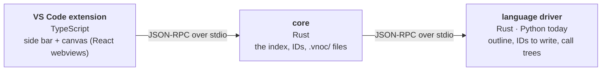

<h1 align="center">
  &nbsp;V-NOC
</h1>

<p align="center">
  <b>Browse your code as a graph in VS Code.</b><br />
  See what a function calls. Attach docs that survive renames.<br />
  <sub>Python today · JavaScript/TypeScript, Rust and more on the way</sub>
</p>

<p align="center">
  <a href="https://marketplace.visualstudio.com/items?itemName=vnoc.vnoc"></a>
  <a href="https://open-vsx.org/extension/vnoc/vnoc"></a>
  <a href="https://github.com/yaredtsy/vnoc/actions/workflows/ci.yml"></a>
  <a href="LICENSE"></a>
  <a href="https://discord.gg/J5nfPHqyBr"></a>
</p>

<p align="center">
  <a href="#install">Install</a> ·
  <a href="#quick-start">Quick start</a> ·
  <a href="#features">Features</a> ·
  <a href="#whats-coming">What's coming</a> ·
  <a href="#how-it-is-built">How it is built</a> ·
  <a href="#contributing">Contributing</a>
</p>

<p align="center">
  
</p>

Every time you open an unfamiliar function you rebuild the same map in your head: where it lives, what it calls, and what someone once
wrote about it. V-NOC lets the computer keep that map. It reads your project, draws it as a tree and a canvas you can explore one level at
a time, and keeps your notes attached to the code they describe, even after the code is renamed or moved.

## Features

<table>
  <tr>
    <td width="33%" valign="top">
      <h3>🌳 Structure, as a tree and a canvas</h3>
      Folders, files, classes and functions in the side bar. Open any part of it as cards on a canvas. <b>Focus</b> on one node and
      both views show only it and what it holds.
    </td>
    <td width="33%" valign="top">
      <h3>🔗 Calls, one level at a time</h3>
      Open a function to see what it calls, as cards joined by dashed lines. <b>Explore</b> a call to jump to where it lives, and climb
      from there. No wall of edges: you choose what to open.
    </td>
    <td width="33%" valign="top">
      <h3>📝 Docs that stay with the code</h3>
      Attach Markdown to a function, class, file or folder. Rename it, move it, <code>git mv</code> its file: the doc is still there.
      Docs are plain files in <code>.vnoc/</code>, so your team sees them when you commit.
    </td>
  </tr>
</table>

## Install

V-NOC is a **pre-release**. In VS Code's Extensions view, search **V-NOC** and choose **Install Pre-Release Version**.

| Where | Get it |
|---|---|
| VS Code | [Visual Studio Marketplace](https://marketplace.visualstudio.com/items?itemName=vnoc.vnoc) |
| Cursor, Windsurf, VSCodium | [Open VSX](https://open-vsx.org/extension/vnoc/vnoc) |
| Offline / by hand | `.vsix` files on the [releases page](https://github.com/yaredtsy/vnoc/releases) |

**Languages:** Python is the first. JavaScript/TypeScript, Rust and more are coming — see [What's coming](#whats-coming).<br />
**Platforms:** macOS (Apple silicon and Intel), Linux x64 and Windows x64.

## Quick start

1. Open a project in VS Code (Python, for now).
2. Click the **V-NOC** icon in the Activity Bar.
3. Click a function to see it, then **Show Calls** to see what it calls.
4. Right-click anything and choose **Add Doc…** to write a note about it.
5. Press `⊞` in the view's title (or run **V-NOC: Open Canvas**) to see the code as a graph.

| Shortcut | Does |
|---|---|
| `Ctrl/Cmd+Alt+N` | **V-NOC: Search…** — find a node by name or path, from anywhere |
| `/` or `Ctrl/Cmd+F` | Search inside the Structure view |
| `Ctrl/Cmd+Enter` | Focus the selected node |
| `Alt+←` | Go back one focus level |

## Docs that survive refactors

<p align="center">
  
</p>

V-NOC writes a short ID into the code and finds the code again by it, so a doc follows its code through renames and moves.
In Python:

| Attached to | Where the ID goes |
|---|---|
| A function or class | One line in its docstring |
| A file | A comment at the top of the file |
| A folder | A hidden `.vnoc-id` file inside it |

A doc whose code is gone shows under **Needs Attention**, where you relink it or remove it.

## What's coming

V-NOC is early, and a lot more is on the way.

<table>
  <tr>
    <td width="50%" valign="top">
      <h3>🌐 More languages</h3>
      Python is the first. JavaScript/TypeScript, Rust and more are next. Each language is one driver program, so adding one does not
      touch the rest of V-NOC.
    </td>
    <td width="50%" valign="top">
      <h3>✏️ Edit on the canvas</h3>
      Edit code and docs right on the canvas cards, without switching to an editor tab.
    </td>
  </tr>
  <tr>
    <td width="50%" valign="top">
      <h3>🤖 Coding agents</h3>
      A <b>CLI</b>, an <b>MCP server</b> and <b>skills</b> so agents (Claude Code, Codex, opencode…) can read and write the docs of a
      node or function, read its code and follow its call tree.
    </td>
    <td width="50%" valign="top">
      <h3>🧭 Walkthrough agent</h3>
      An agent that walks you through a codebase on the canvas, opening functions and calls one step at a time as it explains them.
    </td>
  </tr>
  <tr>
    <td width="50%" valign="top">
      <h3>🔀 Changes as a graph</h3>
      See what changed as functions, not lines: which were added, removed, updated or moved between two versions.
    </td>
    <td width="50%" valign="top">
      <h3>🕓 Function history</h3>
      Who changed <i>this</i> function, when and how, through renames and moves.
    </td>
  </tr>
</table>

| Version | Theme | Status |
|---|---|---|
| 0.1 | The docs loop | ✅ Released |
| **0.2** | **Calls** | ✅ **This release** |
| 0.3 | Edit code and docs on the canvas | 🚧 Next |
| Later | More languages, coding agents (CLI · MCP · skills), walkthrough agent, changes as a graph, function history | 💭 [Planned](docs/futureplan/README.md) |

Have an idea or a language you want first? Say so on [Discord](https://discord.gg/J5nfPHqyBr) or in [an issue](https://github.com/yaredtsy/vnoc/issues/new/choose).

## How it is built



| Folder | What is in it |
|---|---|
| [`crates/`](crates) | The Rust workspace: the core, the domain types, the driver protocol |
| [`drivers/python/`](drivers/python) | The Python language driver (its own Cargo workspace) |
| [`extension/`](extension) | The VS Code extension |
| [`webview/`](webview) | The side bar and canvas (React + Vite) |
| [`shared/`](shared) | TypeScript types and logic shared by the extension and the webview |
| [`docs/`](docs/README.md) | The design notes |

A new language is one driver program: see [docs/06-drivers.md](docs/06-drivers.md). Want to add one? That is a great place to start.

## Contributing

Contributions are welcome. To build from source:

```sh
pnpm install
cargo build
(cd drivers/python && cargo build)
pnpm -r build
```

Then press **F5** in VS Code to run the extension. [CONTRIBUTING.md](CONTRIBUTING.md) has the toolchains, the tests and the conventions.

- 🐞 **Bugs:** run **V-NOC: Report Issue…** in VS Code (it fills in your versions), or [open an issue](https://github.com/yaredtsy/vnoc/issues/new/choose).
- 💬 **Questions and ideas:** join the [Discord](https://discord.gg/J5nfPHqyBr).
- 🔒 **Security:** see [SECURITY.md](SECURITY.md).

## Licence

V-NOC is licensed under [Apache-2.0](LICENSE). Third-party code in the binaries is listed in
[THIRD_PARTY_NOTICES.md](extension/THIRD_PARTY_NOTICES.md). The pictures show [httpx](https://github.com/encode/httpx) (BSD-3-Clause).

---

<p align="center">
  If V-NOC is useful to you, a ⭐ helps other people find it.
</p>
