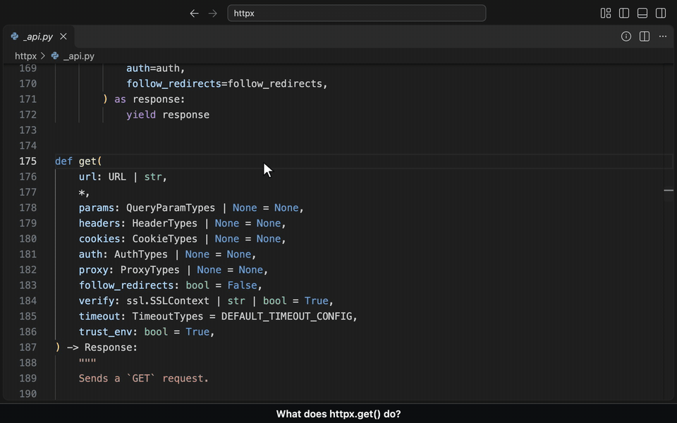
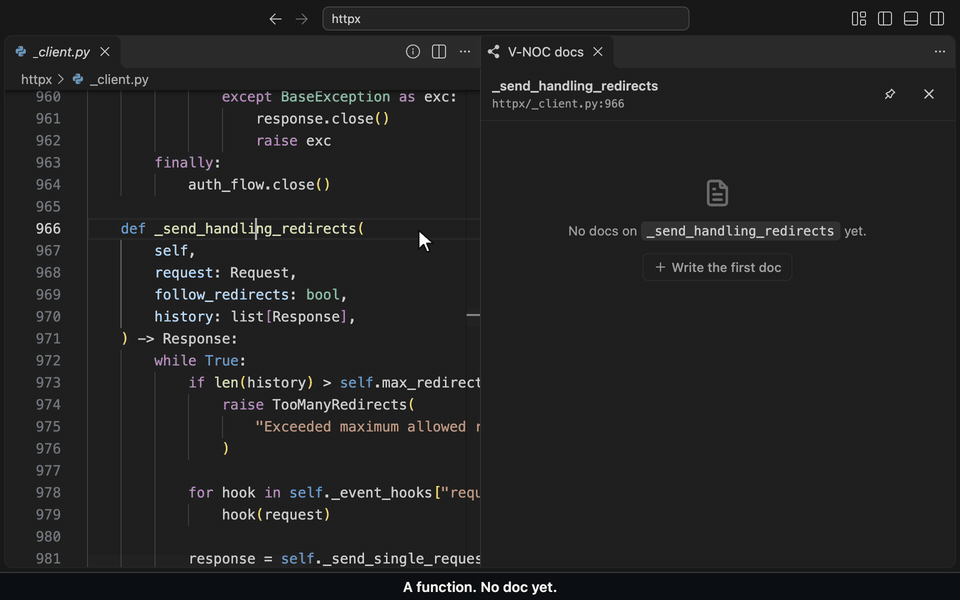
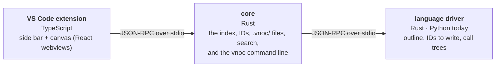

<h1 align="center">
  &nbsp;V-NOC
</h1>

<p align="center">
  <b>Browse your code as a graph in VS Code.</b><br />
  See what a function calls. Attach docs that survive renames.<br />
  <sub>Python today · JavaScript/TypeScript, Rust and more on the way</sub>
</p>

<p align="center">
  <a href="https://marketplace.visualstudio.com/items?itemName=vnoc.vnoc"></a>
  <a href="https://open-vsx.org/extension/vnoc/vnoc"></a>
  <a href="https://github.com/yaredtsy/vnoc/actions/workflows/ci.yml"></a>
  <a href="LICENSE"></a>
  <a href="https://discord.gg/J5nfPHqyBr"></a>
</p>

<p align="center">
  
</p>

Every time you open an unfamiliar function you rebuild the same map in your head: where it lives, what it calls, and what someone once
wrote about it. V-NOC lets the computer keep that map. It reads your project, draws it as a tree and a canvas you can explore one level at
a time, and keeps your notes attached to the code they describe, even after the code is renamed or moved. The same map is there for your
coding agents, through a command line.

## Contents

1. [Features](#features)
2. [Install](#install)
3. [Quick start](#quick-start)
4. [Search](#search)
5. [Docs that survive refactors](#docs-that-survive-refactors)
6. [The `vnoc` command](#the-vnoc-command)
7. [Using V-NOC with coding agents](#using-v-noc-with-coding-agents)
8. [Keyboard shortcuts](#keyboard-shortcuts)
9. [The `.vnoc/` folder](#the-vnoc-folder)
10. [Troubleshooting](#troubleshooting)
11. [What's coming](#whats-coming)
12. [How it is built](#how-it-is-built) · [Contributing](#contributing) · [Licence](#licence)

## Features

<table>
  <tr>
    <td width="33%" valign="top">
      <h3>🌳 Structure, as a tree and a canvas</h3>
      Folders, files, classes and functions in the side bar. Open any part of it as cards on a canvas. <b>Focus</b> on one node and
      both views show only it and what it holds.
    </td>
    <td width="33%" valign="top">
      <h3>🔗 Calls, one level at a time</h3>
      Open a function to see what it calls, as cards joined by dashed lines. <b>Explore</b> a call to jump to where it lives, and climb
      from there. No wall of edges: you choose what to open.
    </td>
    <td width="33%" valign="top">
      <h3>📝 Docs that stay with the code</h3>
      Attach Markdown to a function, class, file or folder. Rename it, move it, <code>git mv</code> its file: the doc is still there.
      Docs are plain files in <code>.vnoc/</code>, so your team sees them when you commit.
    </td>
  </tr>
  <tr>
    <td width="33%" valign="top">
      <h3>✏️ Edit on the canvas</h3>
      Type in a function's code on its card and press <code>Ctrl/Cmd+S</code>: the function in the file has the new text. Docs are
      edited the same way, in the docs panel. A function you changed in the editor meanwhile is never overwritten.
    </td>
    <td width="33%" valign="top">
      <h3>🔎 Search</h3>
      A few letters of a name, a word in a note, a pasted <code>file:line</code> or a traceback line. Filters such as
      <code>kind:fn no:doc in:billing/</code>. The canvas dims every card that is not a hit.
    </td>
    <td width="33%" valign="top">
      <h3>🤖 Coding agents</h3>
      A <code>vnoc</code> command that prints a node, its notes and its code, and a skill that tells Claude Code, Codex, Cursor and
      others when to run it. They read the notes before they change a function.
    </td>
  </tr>
</table>

## Install

V-NOC is a **pre-release**. In VS Code's Extensions view, search **V-NOC** and choose **Install Pre-Release Version**.

| Where | Get it |
|---|---|
| VS Code | [Visual Studio Marketplace](https://marketplace.visualstudio.com/items?itemName=vnoc.vnoc) |
| Cursor, Windsurf, VSCodium | [Open VSX](https://open-vsx.org/extension/vnoc/vnoc) |
| Offline / by hand | the `vnoc-<system>.vsix` files on the [releases page](https://github.com/yaredtsy/vnoc/releases) |

**Languages:** Python is the first. JavaScript/TypeScript, Rust and more are coming: see [What's coming](#whats-coming).<br />
**Platforms:** macOS (Apple silicon and Intel), Linux x64 and Windows x64.

### The `vnoc` command

The command line comes with release **0.3** (it is **experimental**: the command names and the `--json` output can still change). Get it one of three ways.

**From VS Code.** Run **V-NOC: Install `vnoc` Command in PATH** from the Command Palette. On macOS and Linux it makes `~/.local/bin/vnoc`, a link to
the copy inside the extension (the way VS Code installs `code`), and tells you if that folder is not on your `PATH`. On Windows it adds a small
`vnoc.cmd` and the folder to your user `PATH`. **V-NOC: Uninstall `vnoc` Command from PATH** takes back only what that made.

**With a script, without VS Code** (CI, a cloud agent, a server). It picks the build for your system, checks its sum, and only then writes into
`~/.local/bin`:

```sh
curl -fsSL https://github.com/yaredtsy/vnoc/releases/download/v0.3.0/install.sh | sh
```

It runs on macOS (Apple silicon and Intel) and Linux x64. `VNOC_INSTALL_DIR=<folder>` installs somewhere else, and `VNOC_VERSION=0.3.0` names
the release when you run the copy from a checkout. It needs `curl` or `wget`, and `tar`. It does not use `sudo`.

**From a release file.** Each release has `vnoc-cli-<system>.tar.gz` (`vnoc-cli-win32-x64.zip` on Windows) with `vnoc`, the language drivers
`vnoc-driver-*` (they must sit beside `vnoc`: it runs every one it finds there), the licence and the third-party notices. One `SHA256SUMS` lists every file of the release,
and the extension files, the archives and `install.sh` each carry a build attestation:

```sh
grep vnoc-cli-linux-x64.tar.gz SHA256SUMS | sha256sum -c      # on macOS: shasum -a 256 -c
gh attestation verify vnoc-cli-linux-x64.tar.gz -R yaredtsy/vnoc
```

## Quick start

**In VS Code**

1. Open a project (Python, for now).
2. Click the **V-NOC** icon in the Activity Bar.
3. Click a function to see it, then **Show Calls** to see what it calls.
4. Right-click anything and choose **Add Doc…** to write a note about it.
5. Press `⊞` in the view's title (or run **V-NOC: Open Canvas**) to see the code as a graph.

**In a terminal**, in the folder of a Python project:

```
vnoc status
vnoc tree
vnoc find rfor
vnoc show billing/tax.py::rate_for
vnoc doc read billing/tax.py::rate_for
```

The first line says whether V-NOC works here. The notes only exist after the project's owner has run `vnoc init`; until then `vnoc show` still
prints a function's code. `vnoc guide` has a short how-to with examples.

## Search

One query language, in three places: the search box (**V-NOC: Search…**, or the box in the side bar), `vnoc find '<query>'`, and `vnoc tree --where '<query>'`.

It finds:

- **a node by a few letters of its name**: `rfor` finds `rate_for`; a qualified name such as `OrderService.par` works too;
- **a doc by the words in it**, with a snippet: `finance`, or a phrase in quotes, `"retry policy"`;
- **a node by a reference you paste**: `billing/tax.py:7`, `billing/tax.py#L7`, an ID, or a Python traceback line such as `File "billing/tax.py", line 7`.

Filters narrow it. A `-` in front turns one round.

| Filter | Keeps |
|---|---|
| `kind:fn` · `kind:class` · `kind:method` · `kind:file` · `kind:folder` | nodes of that kind (`kind:class,fn` for either) |
| `in:billing/` | nodes in that folder, file or class |
| `has:doc` · `no:doc` | nodes with, or without, docs |
| `tag:plan` · `author:ana` | docs with that tag or author, and the nodes that have one |
| `-in:tests/` · `-tag:done` | everything the filter would keep, turned round |

For example, the functions with no docs in `billing/`:

```
vnoc find 'kind:fn no:doc in:billing/'
```

While the box has text, the canvas dims every card that is not a hit. `vnoc find --help` and `vnoc guide find` have the rest.

<!-- screenshot: the search box with a query such as `kind:fn no:doc in:billing/` typed in, the hits listed under it, and the canvas behind it dimmed except for the hit cards -->

## Docs that survive refactors

<p align="center">
  
</p>

V-NOC writes a short ID into the code and finds the code again by it, so a doc follows its code through renames and moves.
In Python:

| Attached to | Where the ID goes |
|---|---|
| A function or class | One line in its docstring |
| A file | A comment at the top of the file |
| A folder | A hidden `.vnoc-id` file inside it |

A doc whose code is gone shows under **Needs Attention**, where you relink it or remove it. A function whose `ID:` line was lost is listed there
too, under **ID lost**, with **Write ID** to put it back.

**Tags.** A doc can carry tags (`tags:` in its frontmatter), and `.vnoc/tags.toml` says what each tag means. `vnoc tags` lists the tags in use
with how many docs have each; the people who keep the project's vocabulary describe a tag with `vnoc tag describe <tag> "<text>"`.

## The `vnoc` command

The same project, from a terminal and for programs. Everything here is **experimental until 1.0**. `vnoc` alone prints help in a terminal; `vnoc <command> --help` has
every flag, and `vnoc guide` has short how-tos with examples that are checked against the program.

**Read** (these only read; none changes a file):

| Command | Does |
|---|---|
| `vnoc status` | says whether V-NOC works in this project and what it knows |
| `vnoc show <node>` | where a node is, the notes on it and its code |
| `vnoc code <node>` | only the code, with line numbers |
| `vnoc doc read <node>` | the notes themselves (`vnoc doc list`: their titles; `vnoc doc path`: their files) |
| `vnoc tree [<node>]` | the structure of a folder, file or class, with note counts |
| `vnoc find <query>` | nodes and notes, by name, by a word in a note, or by filter |
| `vnoc grep <regex>` | searches the code and answers with the function each hit is in |
| `vnoc calls <node>` | what a function calls, as a tree |
| `vnoc missing` | the documented nodes whose code was not found |
| `vnoc check` | checks the documentation; exit 1 if something is wrong |
| `vnoc tags` | the tags in use, with how many docs have each |

**Write** (each is a decision of the project's people; an agent runs them only when asked):

| Command | Does |
|---|---|
| `vnoc init` | starts V-NOC in a project: creates `.vnoc/` |
| `vnoc doc new <node> --title "<title>"` | attaches a note to a node and prints its file |
| `vnoc doc tag <node> --add <tag>` | adds a tag to (or `--remove`s one from) a node's doc |
| `vnoc tag describe <tag> "<text>"` | writes what a tag means into `.vnoc/tags.toml` |
| `vnoc relink <id> <node>` | points a Missing node's notes at the code's new place |
| `vnoc repair [<node>]` | writes lost `ID:` lines back into the code |

**Set up:**

| Command | Does |
|---|---|
| `vnoc agent install` | writes the skill and the rules block for the coding agents you name (next section) |
| `vnoc agent list` · `status` · `remove` | the agents it knows · what is installed · takes back only what it wrote |
| `vnoc skill` | prints the skill file, as this binary carries it |
| `vnoc guide [<topic>]` | the how-tos |

**Four ways to name a node:** `billing/tax.py::rate_for`, `billing/tax.py:7` (the innermost def that holds line 7), its ID, or a path (a file or a folder).
A wrong name is an error with a suggestion.

**For scripts:** `--json` prints one value, `{ "schema": 1, "command": …, … }` (fields are only ever added); `--format id` and `--format path` print one
location or file per line; `--quiet` leaves out the hints. On a terminal V-NOC shows the control characters of your files as `^[` and the like instead of
passing them on; a pipe gets the bytes as they are. Exit codes: `0` done (also "found nothing"), `1` `check` found problems, `2` the request cannot be met (bad arguments, no such node), `3`
the environment (for example, no driver).

## Using V-NOC with coding agents

An agent that changes a function should read what people wrote about it first. For that it needs three things: the `vnoc` command on its `PATH`,
a **skill** that says when and how to use it, and a few lines in the file it always reads. **Install** gives it the command (above); **`vnoc agent install`** gives it the other two:

```sh
cd your-project
```

```
vnoc agent install --agent claude,codex
```

You name the agents the project's people use, so nothing is written for the ones nobody uses. Run it with no `--agent` in a terminal and a menu lists
them, with the ones it finds ticked. In VS Code the same is **V-NOC: Set Up Coding Agents**: it lists the agents, shows the files it will write, and writes
them. The extension also offers it once, in a project where an agent is in use. Commit the files, so your team's agents get them.

**The agents it knows:** Claude Code, Cline, Codex, Cursor, pi, opencode, GitHub Copilot, Amp, Goose, Windsurf and Gemini CLI by name (`vnoc agent list` says where each reads its skill and
rules), and `other` for any agent that follows the open `AGENTS.md` and `.agents/skills/` convention.

**What each part is**

| Part | What it is | Where it goes |
|---|---|---|
| the **skill** | a short file that tells the agent when to run `vnoc` (before it changes a function, when it is asked how the code is organised) and how to read the answer | `.claude/skills/vnoc/` for Claude Code and Cline, `.agents/skills/vnoc/` for the others |
| the **rules block** | a few lines in the file the agent always reads, so it asks for the skill; it sits between `<!-- vnoc:start -->` and `<!-- vnoc:end -->` and nothing else in the file is touched | `CLAUDE.md`, `AGENTS.md` or `GEMINI.md`, whichever that agent reads |

`vnoc agent install` never overwrites a file of yours: a `SKILL.md` it did not write is left (say `--force` to replace it), and in a rules file only the block is
replaced. `vnoc agent remove` takes back only what it wrote. `vnoc agent status` says whether the files are current.

**The permissions question.** Agents ask before they run a command, and a session that reads code makes many `vnoc` calls, so that would be many questions. For Claude Code
and Codex `vnoc agent install` also asks, in a terminal, whether to let them run V-NOC's **read** commands without asking. Enter means yes. A command
that writes (`doc new`, `doc tag`, `relink`, `repair`, `init`) still asks.

- Claude Code: the entries are added to `permissions.allow` in `.claude/settings.local.json`, the file that is only yours and is not committed
  (`--permissions=project` writes the shared `.claude/settings.json` instead). What is already in the file stays.
- Codex: a rules file of its own, `~/.codex/rules/vnoc.rules`.
- `--permissions` says yes without asking, `--no-permissions` says no and prints the lines to add by hand. With no terminal and neither flag nothing is written: an agent
  or a script never widens its own permissions. In VS Code the question is a ticked item in **Set Up Coding Agents**.

**A short session.** The user asks an agent to change the tax rate for one country. It looks before it edits:

```
vnoc find rate kind:fn
nodes (1)
  function  billing/tax.py::rate_for   lines 6-7   ID 4KF02248CHCTYAG49B0KKZ5SD7   · 1 doc
docs (1)
  Where the rates come from  on billing/tax.py::rate_for
    The table is the finance team's. Do not edit it without asking them.
    .vnoc/nodes/D7/4KF02248CHCTYAG49B0KKZ5SD7/where-the-rates-come-from.md
vnoc show billing/tax.py::rate_for
function  billing/tax.py::rate_for   lines 6-7   ID 4KF02248CHCTYAG49B0KKZ5SD7
docs (1)
  Where the rates come from
    .vnoc/nodes/D7/4KF02248CHCTYAG49B0KKZ5SD7/where-the-rates-come-from.md
  → vnoc doc read billing/tax.py::rate_for
code
  6  def rate_for(country):
  7      return RATES.get(country, 0.0)
vnoc doc read billing/tax.py::rate_for
function  billing/tax.py::rate_for   lines 6-7   ID 4KF02248CHCTYAG49B0KKZ5SD7
── Where the rates come from
   .vnoc/nodes/D7/4KF02248CHCTYAG49B0KKZ5SD7/where-the-rates-come-from.md
The table is the finance team's. Do not edit it without asking them.
```

Three commands, and the agent knows what the code does and that the table is not its to edit, so it asks the user first.

**Other ways to get the skill.** People who manage all their skills with one tool can use `npx skills add yaredtsy/vnoc`. It installs the **skill only**, not the
command and not the rules block, and it offers every agent it knows (more than the list above), so pick the ones you use. `vnoc agent install` stays the recommended way.

<!-- screenshot: the confirmation of "Set Up Coding Agents" in VS Code: the list of files it will write, and the ticked item "Let Claude Code run V-NOC's read commands without asking" -->

## Keyboard shortcuts

| Shortcut | Does |
|---|---|
| `Ctrl/Cmd+Alt+N` | **V-NOC: Search…**: open the search box from anywhere |
| `/` or `Ctrl/Cmd+F` | Move to the search box in the Structure view |
| `Ctrl/Cmd+Enter` | Focus the selected node |
| `Alt+←` | Go back one focus level |
| `F` | Fit the whole canvas into view |
| `Ctrl/Cmd+S` | Save the draft in a card, or in the docs panel, into the file |
| `↑` `↓` `←` `→` `Home` `End` | Move through the Structure view; `←` and `→` close and open a row |

## The `.vnoc/` folder

The docs live in a `.vnoc/` folder at the root of your repository. **Commit it with your code**: your team then sees the same docs.

```
.vnoc/
├── vnoc.toml            the settings (the format number; whether to write IDs into the code)
├── tags.toml            what each tag means (optional)
├── nodes/<xx>/<ID>/     one folder per documented node, with its docs as Markdown files
└── local/               V-NOC's own caches and the trash; git-ignored, not for sharing
```

Each doc is a plain Markdown file with a small header (the node it belongs to, and optionally `author:` and `tags:`), so you can read and edit it
with any tool. The layout is described in [docs/04-storage](docs/04-storage/README.md).

## Troubleshooting

| What you see | What to do |
|---|---|
| `vnoc: command not found` | The folder it was installed in is not on your `PATH`. The install prints the line to add (`export PATH="$HOME/.local/bin:$PATH"` in your shell's startup file), then open a new terminal. |
| `error: no driver found` | The language drivers, the `vnoc-driver-*` files, must sit beside `vnoc`: it runs every one it finds there. Copy them together, or name them: `--driver <path>` (repeat it for more), or `VNOC_DRIVERS` (paths separated as `PATH` is) or `VNOC_DRIVER` (one path). `error: no driver started` lists each driver and why it did not start; `vnoc status` shows a driver that failed on a line of its own. |
| An **ID lost** warning, or `lost marker` in `vnoc check` | The `ID:` line of a function was deleted. **Write ID** in Needs Attention, or `vnoc repair`, puts it back. |
| Bare `vnoc` prints help | That is what it does in a terminal. Pick a command from the list: `vnoc status` is the first one to run. |
| The extension shows nothing | Open a folder that has Python files. **V-NOC: Show Log** says what the core is doing, and **V-NOC: Report Issue…** fills in your versions. |
| The first `vnoc` after an install takes about a second | On macOS the system checks a program it has not run before: about 0.6 s, once for each new copy of `vnoc` and the driver. It is not V-NOC's index. |
| `vnoc` came from both the install script and VS Code | The last one to run wins `~/.local/bin/vnoc`. **Uninstall `vnoc` Command from PATH** in VS Code refuses a copy the script made: remove `~/.local/bin/vnoc` and `~/.local/bin/vnoc-driver-*` by hand. |

## What's coming

V-NOC is early. Three releases are out.

| Version | Theme | Status |
|---|---|---|
| 0.1 | The docs loop | ✅ Released |
| 0.2 | Calls | ✅ Released |
| **0.3** | **Editing on the canvas, search, and the command line for agents** | ✅ **Released** |
| 0.4 | Docs that survive without markers | 💭 Planned |
| 0.5 and on | Polish: more editor features from the core, doc freshness | 💭 Planned |
| 1.0 | Hardening: big repositories, remote machines, the driver protocol frozen | 💭 Planned |

<table>
  <tr>
    <td width="50%" valign="top">
      <h3>🌐 More languages</h3>
      Python is the first. JavaScript/TypeScript, Rust and more are next. Each language is one driver program, so adding one does not
      touch the rest of V-NOC.
    </td>
    <td width="50%" valign="top">
      <h3>🔌 An MCP server</h3>
      The command line is the way agents read V-NOC today. An MCP server and a Claude Code plugin are planned as the next layers.
    </td>
  </tr>
  <tr>
    <td width="50%" valign="top">
      <h3>🧭 Walkthrough agent</h3>
      An agent that walks you through a codebase on the canvas, opening functions and calls one step at a time as it explains them.
    </td>
    <td width="50%" valign="top">
      <h3>🔀 Changes and history</h3>
      See what changed as functions, not lines, and who changed <i>this</i> function, when and how, through renames and moves.
    </td>
  </tr>
</table>

The plans are in [docs/02-mvp-and-releases.md](docs/02-mvp-and-releases.md) and [docs/futureplan](docs/futureplan/README.md). Have an idea or a language you want first? Say so on
[Discord](https://discord.gg/J5nfPHqyBr) or in [an issue](https://github.com/yaredtsy/vnoc/issues/new/choose).

## How it is built



The command line is the core itself: the same `vnoc` program is the editor's core when it is started with `--stdio`, and a command for people and
agents otherwise. Search is one Rust crate that the side bar, `vnoc find` and any other editor call.

| Folder | What is in it |
|---|---|
| [`crates/`](crates) | The Rust workspace: the core and the command line, the domain types, the driver protocol, search |
| [`drivers/python/`](drivers/python) | The Python language driver (its own Cargo workspace) |
| [`extension/`](extension) | The VS Code extension |
| [`webview/`](webview) | The side bar and canvas (React + Vite) |
| [`shared/`](shared) | TypeScript types and logic shared by the extension and the webview |
| [`skills/vnoc/`](skills/vnoc) | The agent skill and the rules block that `vnoc agent install` writes |
| [`docs/`](docs/README.md) | The design notes |

A new language is one driver program: see [docs/06-drivers.md](docs/06-drivers.md). Want to add one? That is a great place to start.

## Contributing

Contributions are welcome. To build from source:

```sh
pnpm install
cargo build
(cd drivers/python && cargo build)
pnpm -r build
```

Then press **F5** in VS Code to run the extension. [CONTRIBUTING.md](CONTRIBUTING.md) has the toolchains, the tests and the conventions.

- 🐞 **Bugs:** run **V-NOC: Report Issue…** in VS Code (it fills in your versions), or [open an issue](https://github.com/yaredtsy/vnoc/issues/new/choose).
- 💬 **Questions and ideas:** join the [Discord](https://discord.gg/J5nfPHqyBr).
- 🔒 **Security:** see [SECURITY.md](SECURITY.md).

## Licence

V-NOC is licensed under [Apache-2.0](LICENSE). Third-party code in the binaries is listed in
[THIRD_PARTY_NOTICES.md](extension/THIRD_PARTY_NOTICES.md). The pictures show [httpx](https://github.com/encode/httpx) (BSD-3-Clause).

---

<p align="center">
  If V-NOC is useful to you, a ⭐ helps other people find it.
</p>
