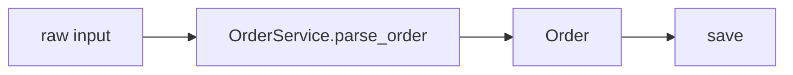

# tour: explain code as a tour the user plays

A tour is your explanation, cut into stops. A stop is one function, class, file or folder, with the lines that matter lit and a short text.
The user plays it on the V-NOC canvas: each stop appears the moment you add it. The tour is the answer.
Say nothing in the chat from start to finish, not even a short line beside an add. After the finish line, at most one more line, and only for what the user must know that the tour cannot say.

## A whole tour, start to finish
Four commands. Each prints what it did. The text goes in on standard input, as a heredoc.
One `vnoc tour` command per call, with the tour's id written out: no `T=…` or `$T`, no `for` loops, no two commands joined with `;` or a newline.
The host allows only a command it can read, and asks the user about anything else. Run `finish` on its own, after the last `add` printed `written`.
Read a function with `vnoc code <node>`, a file or a folder with `vnoc show <node>`. Quote a node with `<` or `>` in it: `'a.py::f.<locals>.g'`.
Send one `add` at a time and read its answer before the next: never several in one message. The answer may be a refusal to fix, or Stop.
```
vnoc tour start --title "orders" --question "how does an order get parsed" --author claude-code
started orders-7k2q   private   .vnoc/local/tours/orders-7k2q.jsonl
next: vnoc tour add orders-7k2q <node> --body-file -   (vnoc guide tour)
vnoc tour add orders-7k2q orders/service.py::OrderService.parse_order --body-file - <<'EOF'
parse_order is where raw input becomes an Order: it builds a Line for each item, then wraps them with the number.
EOF
s1 written   stop 1   ƒ OrderService.parse_order   orders/service.py:10-13   1 step   · 1 stop written
vnoc tour add orders-7k2q orders/models.py::Order --from s1 --line 13 --body-file - <<'EOF'
An Order is its number and its lines. Nothing is checked on the way in, and the total is worked out when it is asked for.

## 15-17 Two fields and nothing else
The constructor only keeps what it is given, so parse_order can build an Order from lines it has just made.

## 19-21 The total is a sum, not a stored number
It adds up the amount of each line every time, so a line changed later can never leave the total wrong.
EOF
s2 written   stop 2   ◆ Order   orders/models.py:14-21   3 steps   · 2 stops written
  s2.b1  15-17   def __init__(self, number, lines):
  s2.b2  19-21   @property
vnoc tour finish orders-7k2q
finished: 2 stops, 4 steps
ask the user  1 stop has no ID: the tour will not follow a rename.        vnoc tour ids orders-7k2q
not pinned: this is not a git repository
```
`add` answers with the first line of each block it lit. If a first line is not the one you meant, the numbers were wrong: `--replace` the stop.

## The structure
```
stop s1          a node: its intro, then its blocks
  block b1       a part of the node: lines inside it, one paragraph
    block b2     a detail of b1: lines inside b1's (one level of detail)
  stop s2        a stop reached from s1: --from s1 (and --line 13 for a call)
```
- The reader goes: s1's intro, b1, b2, the next block, then the stop nested in s1, then the next stop. Next and Previous walk that order.
- A stop is a step too: its intro. A function under 8 lines has the intro only.
- Ids are never used again: a dropped `s2` leaves `s2` empty for good.

## The text of a stop
    <the intro: what this node is for>

    ## 15-17 <a title: a phrase, no full stop>
    <why these lines are there>

    ### 15-16 <a detail inside lines 15-17>
    <text>

The line numbers are the file's, as `vnoc code` printed them (`## 24` is one line). Budgets, in characters, by `--detail`
(`quick`, `normal` the default, `detailed`; set at `start`). Only the prose counts, not fences or tables:

| | quick | normal | detailed |
|---|---|---|---|
| a stop's intro | 240 | 420 | 720 |
| a block's text | 240 | 420 | 900 |
| a `--same-as` sentence | 180 | 180 | 240 |
| a title | 60 | 60 | 60 |

At most 12 blocks in a stop (details count), 40 stops in a tour, 64 KB of text in a call. A text may hold paragraphs, `code`, *emphasis*,
**strong**, lists, tables (12 rows), quotes, links, code fences (30 lines) and one ` ```mermaid ` fence. Refused: HTML, images, headings,
a second diagram. Nothing is written when anything is wrong. Every problem is listed; fix them all, send the whole stop:
```
vnoc tour start --title "orders"
vnoc tour add orders-7k2q orders/models.py::Order --body-file - <<'EOF'  # exit 2
## 15-17 Two fields
The constructor keeps what it is given.

### 15-16 A detail
It sets two names.

## 16-18 Overlaps
Lines of the first block.
EOF
error: not written: 2 problems
  fix them, then send the whole stop again
    intro: there is none. Start with a paragraph on what this is for, before the first heading
    blocks 1 and 3 both light line 16
vnoc tour add orders-7k2q orders/service.py::OrderService.place --body-file - <<'EOF'  # exit 2
place parses, saves and returns.

## 16-17 Parse, then save
It does both.
EOF
error: not written: 1 problem
  fix them, then send the whole stop again
    OrderService.place is 4 lines: a stop this short is one step. Put it all in the first paragraph
```
Others you may meet: `intro: 533 of 420 characters` (a budget), `block 1 title ends with a full stop`, `block 2: lines 30-35 are outside Order (14-21)`,
`--line 99 is outside OrderService.parse_order (10-13)`, `--from s7: this tour has no stops yet`, `no stop s9 in this tour` with the nearest ids. A refusal is a to-do list: do not send the same text again.

## Writing well
Say why, not what. The code is on screen beside the text.
```markdown
bad:   It loops over the items and makes a Line for each one, then returns an Order.
good:  Parsing and building are one step, so a half-built Order can never be seen by a caller.

bad:   Title: "retry_charge" (the function's name, which the stop already has)
good:  Title: "Retry only a dropped connection" (what the part does)

bad:   ten blocks of three lines each, side by side
good:  three blocks for the three parts, and a ### inside the one part that needs taking apart

bad:   a second full stop on check_stock, retelling it
good:  --same-as s2, one sentence: "Called again here, before the stock is taken."

bad:   a list or a code fence that retells the stop's own lines (they are on screen)
good:  a list for things to tell apart; a fence for what is not on screen: an example call, a payload
```
A flow across stops or files is a diagram: one ` ```mermaid ` flowchart a step, best in the first stop's intro of a tour across files.
One that retells a function's body is the same bad fence; draw the files and the calls between them:
```
vnoc tour start --title "orders" --question "how does an order get saved" --author claude-code
vnoc tour add orders-7k2q orders/service.py::OrderService.place --body-file - <<'EOF'
place is the front door of an order: raw input in, a saved Order out.


EOF
```
Most stops need two or three `##` blocks and no `###`. No block for a line that only starts or returns. A stop planned as a second visit (`= s2` in `show` and `route`) takes `--same-as s2` too;
the plan does not do it for you.

## The route
- `--from <stop>` says the tour got here from that stop. With `--line <n>` it is a call on line n of that stop's node (the stage says
  "called on line 13"). Without, it is containment: a method of a class, a file of a folder; never use it to chain stops that do not contain each other.
- `--same-as <stop>` is for a node already explained: one sentence, no blocks.
- A tour need not be a tree. Stops with no `--from` are at the top, in the order you add them.
- **Planning** puts stops on the route before they are written: the user sees the outline at once, and "stop 3 of 10". It is optional.
  `vnoc tour start --title "<title>" --plan <node> <node>` and `vnoc tour plan <id> <node> --from <stop>` plan; `add` on a planned node fills it (it
  says so), and `finish` removes what is left.
  For a tour across files (a question, not one function's call tree), find the route first, then start with `--plan <the nodes in reading order>` and fill it
  with `add`, in that order: `vnoc tour start --title "…" --question "…" --author <your name> --plan <node> <node> …`. Stops are not reordered afterwards
  with `--replace`. The plan fixes only the order: write each stop's text right after reading it. Otherwise do not prepare the whole tour first. `route` proposes a plan from the call tree:
```
vnoc tour route orders/service.py::OrderService.place --depth 2
OrderService.place    1 stop    about 1 min
and what it calls     2 stops   about 2 min      --depth 1
and what those call   4 stops   about 3 min      --depth 2

 1  ƒ OrderService.place          orders/service.py:15
 2    ƒ OrderService.parse_order  orders/service.py:10  line 16
 3      ◆ Line                    orders/models.py:4    line 12
 4      ◆ Order                   orders/models.py:14   line 13
```
Depth 0 is the node alone; 6 is the most. A function that is called twice is one stop, with the first line. A node met again is a stop
with `= k` (the first stop on it) that is not walked again. A call to code the index does not know is not a stop. For a class, a file or a folder,
depth is containment. `vnoc tour start --title "<title>" --route <node> --depth 2` plans exactly that outline; `--plan` and `--route` do not go together.
```
vnoc tour start --title "orders" --route orders/service.py::OrderService.place --depth 2
started orders-7k2q   private   .vnoc/local/tours/orders-7k2q.jsonl
planned 4 stops
  s1  ◌ OrderService.place   orders/service.py
  s2  ◌ OrderService.parse_order   orders/service.py  ← s1 line 16
  s3  ◌ Line   orders/models.py                       ← s2 line 12
  s4  ◌ Order   orders/models.py                      ← s2 line 13
next: vnoc tour add orders-7k2q <node> --body-file -   (vnoc guide tour)
vnoc tour add orders-7k2q orders/service.py::OrderService.place --body-file - <<'EOF'
place is the front door: it turns the raw request into an order, then keeps it.
EOF
s1 written (it was planned)   stop 1   ƒ OrderService.place   orders/service.py:15-18   1 step   · 1 of 4 stops written
vnoc tour finish orders-7k2q
finished: 1 stop, 1 step · 3 planned stops left the route
ask the user  1 stop has no ID: the tour will not follow a rename.        vnoc tour ids orders-7k2q
not pinned: this is not a git repository
```

## How big
Up to about 12 stops: just write it. More: ask the user one question first, with two or three sizes named by what each adds, and the minutes:
"only place (1 min) · and what it calls (2 min) · and what those call (3 min)". The lines of `route` are those sizes. 40 stops is the most one
tour holds; a route past it is cut there and says so. A tour of a folder is a good place to ask:
```
vnoc tour route orders/service.py --depth 1
service.py             1 stop    about 1 min
and what is in it      2 stops   about 2 min      --depth 1
and what is in those   6 stops   about 4 min      --depth 2

 1  ▪ service.py      orders/service.py
 2    ◆ OrderService  orders/service.py:6
```

## Where the reader is
When the user says "explain this more" or "why is that there" while a tour is open, run `vnoc tour where` first. It prints the step they are on.
```
vnoc tour start --title "orders" --question "how does an order get parsed" --author claude-code
vnoc tour add orders-7k2q orders/service.py::OrderService.parse_order --body-file - <<'EOF'
parse_order is where raw input becomes an Order.
EOF
vnoc tour add orders-7k2q orders/models.py::Order --from s1 --line 13 --body-file - <<'EOF'
An Order is its number and its lines.

## 15-17 Two fields and nothing else
The constructor only keeps what it is given.

## 19-21 The total is a sum, not a stored number
It adds up the amount of each line every time.
EOF
vnoc tour where
no tour has been opened or moved yet
name one: vnoc tour where <tour>
vnoc tour go orders-7k2q s2.b2 | tail -n +2
stop 2 of 2 · step 3 of 3     s2.b2
◆ Order   orders/models.py:19-21
  The total is a sum, not a stored number
  It adds up the amount of each line every time.
  > 19      @property
  > 20      def total(self):
  > 21          return sum(line.amount() for line in self.lines)
before: s2.b1 "Two fields and nothing else" · after: end
vnoc tour go orders-7k2q back | tail -n +2
cover · 2 stops · 4 steps
  "how does an order get parsed"
after: s1 (intro)
vnoc tour go orders-7k2q back | head -1
nothing to go back to
```
The first line (cut off above, it has the time) says the tour, whether it is open on a canvas, and how long ago the reader moved: `moved 12 s ago`
is "they are looking at it"; `moved 2 days ago` is "they were here once". Then the stop's number and the step's, the node and the
lit lines, `>` marking each lit line, the title and text, and the steps before and after. `where` takes a tour, or answers for the tour that moved last.
If it says no tour has been opened or moved yet, ask which tour. `vnoc tour go <id> <move>` moves the user's screen (`next`, `prev`, `next-stop`,
`prev-stop`, `back`, `cover`, `end`, `s4`, `s3.b2`): only when they ask to be taken somewhere. A jump (`s4`, `cover`) remembers where the reader was, and `back`
returns there; `next` and `prev` remember nothing.

## After
- A new session: `vnoc tour list`, then `vnoc tour show <id> --text` prints the outline with the ids (the ones `--from` takes) and every text.
- Out of date: `vnoc tour check` says which stops no longer match the code. Fix each with `vnoc tour add <id> <node> --replace <stop> --body-file -` and the new text.
- `vnoc tour drop <id> <stop>` takes a stop (and what is nested in it) or a block off. Ids are not reused.
- After the user stopped the tour: add nothing more, say the one line it gives you. `vnoc tour resume <id>` only when the user says to go on.
```
vnoc tour start --title "orders" --question "how does an order get parsed" --author claude-code
vnoc tour add orders-7k2q orders/service.py::OrderService.parse_order --body-file - <<'EOF'
parse_order is where raw input becomes an Order.
EOF
vnoc tour add orders-7k2q orders/models.py::Order --from s1 --line 13 --body-file - <<'EOF'
An Order is its number and its lines.

## 15-17 Two fields and nothing else
The constructor only keeps what it is given.

## 19-21 The total is a sum, not a stored number
It adds up the amount of each line every time.
EOF
vnoc tour show orders-7k2q --text
orders   "how does an order get parsed"
private · writing · 2 stops · 4 steps · by claude-code · not pinned (being written)
 1  s1  ƒ OrderService.parse_order  orders/service.py:10-13  1 step
      parse_order is where raw input becomes an Order.
 2  s2    ◆ Order                   orders/models.py:14-21   3 steps  ← s1 line 13
      An Order is its number and its lines.
    s2.b1  15-17  Two fields and nothing else
      The constructor only keeps what it is given.
    s2.b2  19-21  The total is a sum, not a stored number
      It adds up the amount of each line every time.
vnoc tour check | tail -n 1
1 tour · all fresh
vnoc tour drop orders-7k2q s2.b2
dropped s2.b2
```

## After finish
Two settings in `.vnoc/vnoc.toml`, each `always`, `ask` (the start) or `never`; they are the user's, never yours to change:
```
vnoc tour settings
ids    ask     the default
commit ask     the default
```
- `ids`: give the tours' nodes an ID, so the tour follows a rename (`ID:` lines in the code, so it edits source files).
- `commit`: commit the tour's files that are not committed, so the tour can be pinned.
- `ask`: `finish` prints a line that starts with `ask the user`. Ask the user as a question in your last message, ending in `?`, naming the files; run the command on
  the line only after a yes. `always`: `finish` did it and says so; ask nothing. `never`: it says `not pinned` with no command after it; put "not pinned"
  in your last line and offer nothing.
- **Pinned** means one commit holds every stop's code as the tour was written. A pinned tour shows the old code when the code later changes.
  `vnoc tour pin <id>` pins when it can; `vnoc tour pin <id> --commit` commits the tour's files first, and nothing else.
  `vnoc tour ids <id>` writes the IDs. All three are the user's: run one only when they ask for exactly that.

## The user's commands
`vnoc tour ids`, `edit` (title, question, detail), `share` (move a finished tour to `.vnoc/tours/`, to commit it), `delete` (to the trash),
`settings`. They touch more than a tour: only when asked. `vnoc tour export <id>` prints a tour as one JSON document, nested; `vnoc tour import`
makes a tour from one, and `import --replace <id>` writes it over a tour. They are for a person or a script. You still write stop by stop:
a document arrives whole, so nobody can read along, and one bad stop refuses it all.

## What the user sees
- A route on the left: the stops in order, nested as you nested them, with `◌` for one that is planned.
- The stage in the middle: the code, the lit lines of the step, your text beside it, `Next` and `Previous`.
- A map of the stops and how they call each other, drawn from `--from`.
- Short steps read well here: a step is read in seconds, so one paragraph, one reason.
- Stop is a button. After it, your next command is refused with the line to say.
