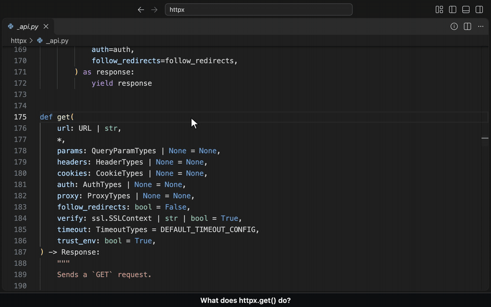
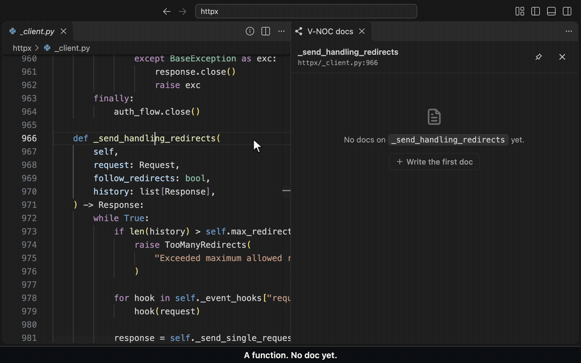

# V-NOC

Browse Python code as a tree and a canvas, follow what a function calls, and attach docs that stay with the code when it is renamed or moved.

**This is a pre-release.** It works on Python code only, on macOS (Apple silicon and Intel), Linux (x64) and Windows (x64).

## How to start

1. Open a Python project.
2. Open the V-NOC view in the Activity Bar.
3. Click a function in the **Structure** view to see it; double-click to open its code.
4. Right-click a function, class, file or folder and choose **Add Doc…**.
5. Run **V-NOC: Open Canvas** (or the `⊞` button in the view's title) to see the code as a graph.

## What it does

- **Structure** (the side bar): the folders, files, classes and functions of the project, with a search box (`/` or `Ctrl/Cmd+F`), the arrow keys, and type-ahead. A click shows the node on the canvas when it is open, and its code otherwise.
- **Focus** a node (`⌖`, or `Ctrl/Cmd+Enter`) to show only it and what it holds, on the side bar and the canvas together. `Alt+←` goes back one level.
- **The canvas** draws what you open as cards. Open a function (**Show Calls**, or its chevron) to see what it calls, one level at a time, as cards joined by dashed lines.
- **Explore** a call (double-click its card): it opens in its own panel in the side bar, with the function where it lives, and the canvas follows. Each context has a chip in the canvas's bar and a panel in the side bar.
- A doc is attached to a function, class, file or folder. It is found again after a rename or a move: V-NOC writes a short ID into the code (a docstring line) and follows it.
- Docs that lost their code show under **Needs Attention**, where you can relink or remove them. A removed doc can be restored.

## The menus

Right-click anything V-NOC draws; the entries say what happens.

| Where | What you get |
|---|---|
| a card or a row of the Structure view | Focus (or Back, on the focused one) · Open in Canvas (row) or Reveal in Sidebar (card) · Expand / Collapse · Expand All Below · Show Calls · Go to Code · Show / Hide Code in Card · Reveal in Explorer · Show Docs · Add Doc… · Attach a Missing Doc Here… · Write ID · Copy Path |
| a call card | Explore · Expand / Collapse · Go to Call Site… (a list of every place it is called, with a preview) · Go to Code · Show / Hide Code in Card · Show Docs · Add Doc… · Copy Path |
| the canvas background | Fit View · Collapse All · Back · Clear Focus · Clear Selection · Close Explore |
| a panel's header in the Structure view | Close · Close Others |
| the code editor, an editor tab | **V-NOC ▸** Reveal in Sidebar · Open in Canvas (beside the code) · Focus · Show Calls · Show Docs · Add Doc… · Attach a Missing Doc Here… · Write ID |
| the Explorer | **V-NOC ▸** Reveal in Sidebar · Open in Canvas · Focus · Show Docs · Add Doc… |

`V-NOC: Search…` (`Ctrl/Cmd+Alt+N`) finds a node by name or path from anywhere.

## The `.vnoc/` folder

The docs live in a `.vnoc/` folder at the root of your repository. Commit it with your code: your team then sees the same docs.

## Accessibility

Rows and cards are labelled for screen readers (*"function checkout, selected, 1 doc, cursor here, level 3, 2 of 4"*), the Structure view is a tree you can drive with the keyboard, and with *Reduce motion* on nothing pulses and spinners are still dots. The colours follow your theme, High Contrast included.

## What it does not do yet

- Languages other than Python.
- Linux and Windows on ARM.
- Editing code or docs inside the canvas: "Go to Code" opens the editor, and a doc is edited in a normal editor tab.
- Private docs that are not committed.

## Feedback

**V-NOC: Report Issue…** fills in your versions and opens a GitHub form. Questions: [Discord](https://discord.gg/J5nfPHqyBr). The source: [GitHub](https://github.com/yaredtsy/vnoc).

## Licence

Apache-2.0. Third-party code in the binaries: [THIRD_PARTY_NOTICES.md](https://github.com/yaredtsy/vnoc/blob/main/extension/THIRD_PARTY_NOTICES.md).
